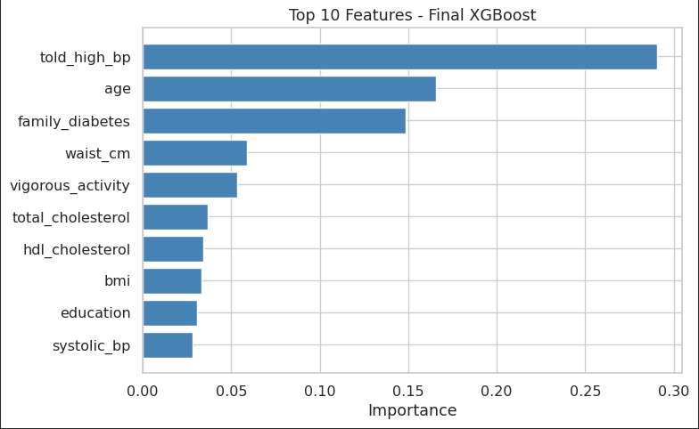
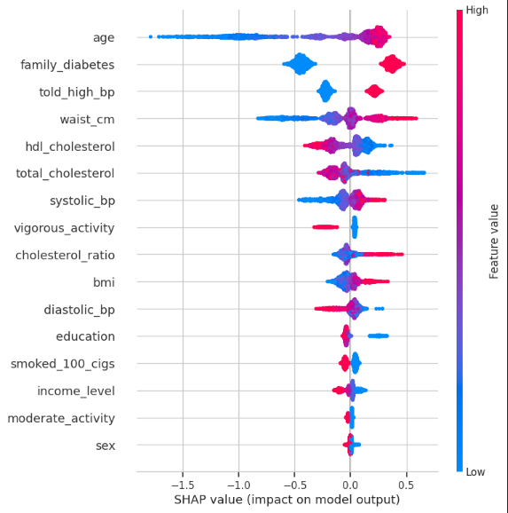
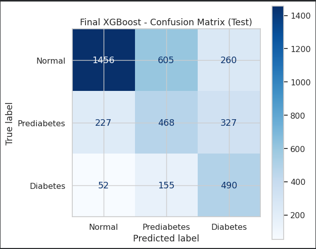
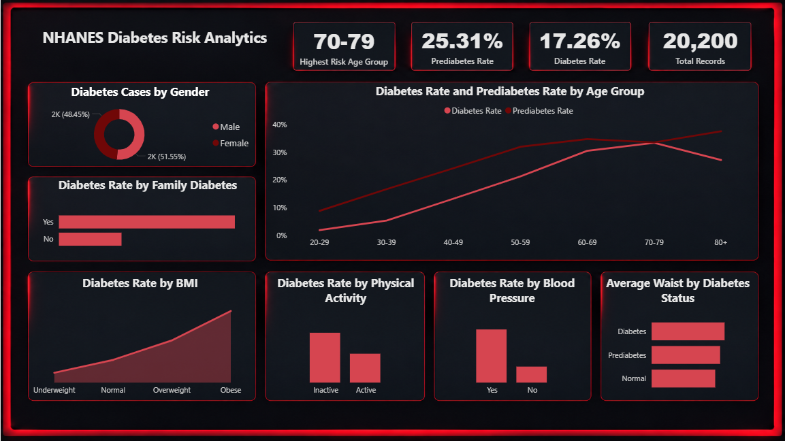
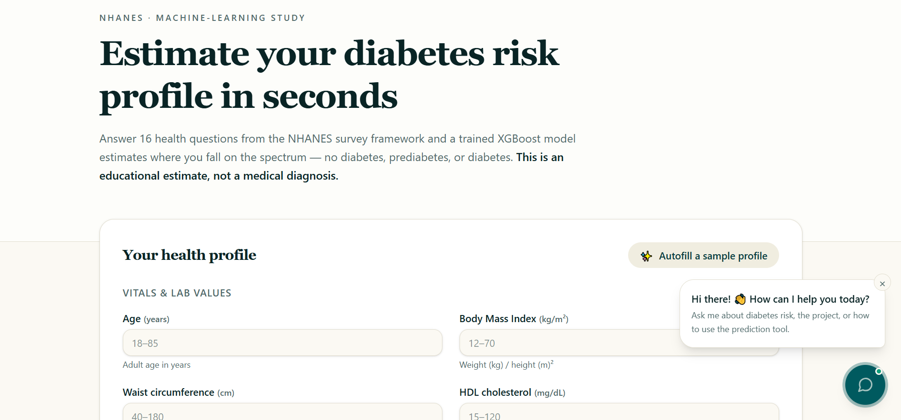
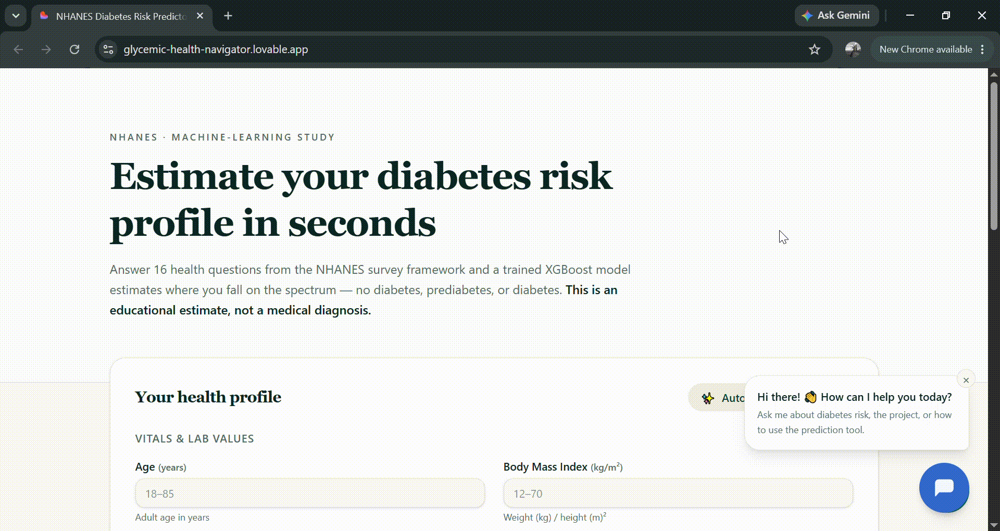

<a id="project-title"></a>
# Diabetes Risk Prediction with CDC NHANES Data

<a id="brief-summary"></a>
**Brief one-line summary:** An end-to-end ML project that classifies U.S. adults as Normal, Prediabetes, or Diabetes using demographic, body-measure, blood-pressure, cholesterol, lifestyle, and family-history features—without using blood-sugar measurements as model inputs. The project includes data engineering, model evaluation, explainability, a Power BI dashboard, a web app, and a Botpress chatbot.

<a id="overview"></a>
## Overview

This project builds a three-class prediction pipeline from public CDC NHANES survey data. It combines multiple survey cycles, creates labels using HbA1c and diagnosis information, then removes those label-defining fields from the model inputs. It also adds global diabetes context by scraping public IDF Diabetes Atlas tables for country-level estimates.

> **Disclaimer:** This is a learning and portfolio project. It is not a medical device and cannot diagnose diabetes or prediabetes. Only a blood test (HbA1c) and a doctor can do that.

## Table of Contents

- <a href="#project-title">Project Title</a>
- <a href="#brief-summary">Brief One-Line Summary</a>
- <a href="#overview">Overview</a>
- <a href="#problem-statement">Problem Statement</a>
- <a href="#dataset">Dataset</a>
- <a href="#tools-and-technologies">Tools and Technologies</a>
- <a href="#methods">Methods</a>
- <a href="#key-insights">Key Insights</a>
- <a href="#dashboard-model-and-output">Dashboard / Model / Output</a>
- <a href="#interactive-web-application">Interactive Web Application</a>
- <a href="#how-to-run-this-project">How to Run This Project</a>
- <a href="#results-and-conclusion">Results and Conclusion</a>
- <a href="#future-work">Future Work</a>
- <a href="#author-and-contact">Author and Contact</a>

---

<a id="problem-statement"></a>
## Problem Statement

Diabetes and prediabetes are important public-health concerns, but a prediction model that does not use direct blood-sugar measurements faces a meaningful information limit. This project investigates how well commonly available demographic, body-measure, blood-pressure, cholesterol, lifestyle, and family-history features can distinguish Normal, Prediabetes, and Diabetes labels in NHANES data. It is an educational modeling exercise, not a clinical screening or diagnostic tool.

## What is in this project

| Component | What it is |
|---|---|
| **Notebook** | The full pipeline: data download, SQL integration, cleaning, EDA, modeling, tuning, explainability and model saving (`NHANES_Diabetes_Risk_Prediction.ipynb`) |
| **Web app** | A diabetes risk app where a user enters the model's input features and gets the predicted class from the saved model |
| **Dashboard** | An interactive "NHANES Diabetes Risk Analytics" dashboard built from the decoded dataset (`nhanes_dashboard.csv`) |
| **Chatbot** | A Botpress chatbot that answers questions about the project, grounded in a knowledge base document (`nhanes_project_knowledge_base.md`) |
| **Saved model** | The final tuned XGBoost pipeline, preprocessing included (`final_model.joblib`) |

---

## Key results

Final model: **tuned, class-weighted XGBoost pipeline**, evaluated once on a held-out test set of 4,040 people.

| Metric | Test result |
|---|---|
| Accuracy | 0.5975 |
| Macro precision | 0.5584 |
| Macro recall | 0.5961 |
| Macro F1 | 0.5621 |
| ROC-AUC (one-vs-rest, macro) | 0.7787 |

| Class | Precision | Recall | F1 | People in test set |
|---|---|---|---|---|
| Normal | 0.84 | 0.63 | 0.72 | 2,321 |
| Prediabetes | 0.38 | 0.46 | 0.42 | 1,022 |
| Diabetes | 0.45 | 0.70 | 0.55 | 697 |

Confusion matrix (rows = true class, columns = predicted class):

| True \ Predicted | Normal | Prediabetes | Diabetes |
|---|---|---|---|
| Normal | 1,456 | 605 | 260 |
| Prediabetes | 227 | 468 | 327 |
| Diabetes | 52 | 155 | 490 |

**Main finding:** without blood sugar information, six different model types, class weighting, SMOTE, hyperparameter tuning and stacking all end up at about the same level (macro F1 about 0.55 to 0.56, ROC-AUC about 0.77 to 0.78). The limit comes from the information in the features, not from the choice of model. Prediabetes is the hardest class because it lies between Normal and Diabetes on every available feature. The model finds Diabetes best (recall 0.70) and only 52 of 697 people with diabetes were called Normal.

---

<a id="dataset"></a>
## Dataset

- **Source:** CDC National Health and Nutrition Examination Survey (NHANES), cycles 2011-2012, 2013-2014, 2015-2016 and 2017-2018.
- **Built from scratch:** 11 public `.XPT` files per cycle (demographics, body measures, blood pressure, cholesterol, questionnaires, HbA1c) were downloaded with Python, loaded into a **SQLite** database and joined with **SQL** on the respondent ID (`SEQN`).
- **Population:** 20,200 adults (age 20 or older) with a valid HbA1c result.
- **Target (ADA criteria):**
  - 0 Normal: HbA1c below 5.7%
  - 1 Prediabetes: HbA1c 5.7% to 6.4%
  - 2 Diabetes: HbA1c 6.5% or higher, or a doctor-diagnosed diabetes
- **Class balance:** about 57.4% Normal, 25.3% Prediabetes, 17.3% Diabetes.
- **Leakage prevention:** HbA1c and the doctor-diagnosis answer were used only to build the label and were then removed. No glucose variable was used.

### The 16 model features

| Group | Features |
|---|---|
| Numeric (8) | `age`, `bmi`, `waist_cm`, `hdl_cholesterol`, `total_cholesterol`, `systolic_bp`, `diastolic_bp`, `cholesterol_ratio` |
| Ordered categories (2) | `education` (5 levels), `income_level` (5 levels, from the income-to-poverty ratio) |
| Yes/No and male/female (6) | `sex`, `told_high_bp`, `family_diabetes`, `smoked_100_cigs`, `vigorous_activity`, `moderate_activity` |

Blood pressure is the average of up to four readings. `cholesterol_ratio` is total cholesterol divided by HDL. Three engineered features (`pulse_pressure`, `hypertension_measured`, `physical_activity`) were tested and removed because they only repeat information already in other columns.

---

<a id="methods"></a>
## Methods and Project Workflow

1. **Data acquisition:** download NHANES `.XPT` files across four cycles
2. **Data integration:** SQLite and SQL joins on `SEQN`
3. **Target engineering:** 3-class label from HbA1c and doctor diagnosis
4. **Data cleaning:** decode answer codes, handle refused/unknown answers, drop about 2% of rows with missing questionnaire answers
5. **Feature engineering:** average blood pressure readings, income levels, cholesterol ratio
6. **Exploratory data analysis:** class distribution, risk factors by diabetes status, correlations, missingness
7. **Preprocessing pipeline:** stratified 80/20 split, then one `ColumnTransformer` (median imputation and `RobustScaler` for numeric features, ordered encoding for ordinal features, 0/1 encoding for two-category features), wrapped with each model in a Scikit-learn `Pipeline` to prevent leakage
8. **Model training and cross-validation:** six models, stratified 5-fold cross-validation
9. **Class imbalance handling:** no handling vs class weighting vs SMOTE
10. **Hyperparameter tuning:** random search on training data only, plus a stacking ensemble
11. **Final evaluation:** classification report, confusion matrix, macro scores and a Prediabetes threshold test
12. **Explainability:** feature importance and SHAP
13. **Conclusions and limitations**
14. **Saving the final model** with Joblib

---

<a id="key-insights"></a>
## Models and Key Insights

Six models were compared with stratified 5-fold cross-validation: Extra Trees, HistGradientBoosting, XGBoost, CatBoost, LightGBM and an RBF-kernel SVM.

| Model (class weighted) | Accuracy | Macro F1 | ROC-AUC |
|---|---|---|---|
| XGBoost | 0.5941 | 0.5551 | 0.7737 |
| CatBoost | 0.5923 | 0.5549 | 0.7740 |
| LightGBM | 0.5956 | 0.5541 | 0.7709 |
| SVM | 0.5861 | 0.5509 | 0.7765 |
| HistGradientBoosting | 0.5910 | 0.5503 | 0.7701 |
| Extra Trees | 0.5822 | 0.5351 | 0.7617 |

- **Class weighting** raised macro F1 for every model (about 3 points for the boosted trees, more for SVM and Extra Trees) and raised macro recall by 5 to 10 points, at the cost of about 4 points of accuracy. ROC-AUC did not change.
- **SMOTE** (LightGBM, inside an imbalanced-learn pipeline) gave a similar macro F1 (0.557 on the test set) but lower recall for the minority classes, so it was not used.
- **Tuning** (random search, macro F1): XGBoost reached a cross-validated macro F1 of 0.559, compared with 0.555 for the default settings.
- **Stacking** the tuned models gave a test macro F1 of 0.5603, no better than the single XGBoost (0.5621), so the simpler model was chosen as the final model.
- **Prediabetes threshold test:** changing the decision weight for Prediabetes raised precision only slightly while recall fell sharply, so the default rule was kept.

---

## Feature Importance and Explainability

The charts below are stored in the repository and summarize the final model's learned feature importance and SHAP-based explanations.

### Feature importance



### SHAP summary



### Confusion matrix



Which features the final model relies on most:

1. **Age:** older age pushes strongly toward Diabetes
2. **Family history of diabetes**
3. **Ever told of high blood pressure**
4. **Waist circumference:** a larger waist pushes toward Diabetes
5. Then HDL cholesterol (higher HDL pushes away from Diabetes), total cholesterol, systolic blood pressure, vigorous activity (doing it pushes away from Diabetes), cholesterol ratio and BMI

SHAP values and the model's built-in importance agree on the top group. These methods describe how the model behaves. They do not show that a feature causes diabetes.

---

## Using the saved model

The saved file contains the whole pipeline (preprocessing and model). It was trained with a small custom class, so that class must be defined before loading:

```python
import joblib
import pandas as pd
from xgboost import XGBClassifier
from sklearn.utils.class_weight import compute_sample_weight

class XGBBalanced(XGBClassifier):
    def fit(self, X, y, **kwargs):
        return super().fit(X, y, sample_weight=compute_sample_weight("balanced", y), **kwargs)

model = joblib.load("final_model.joblib")

person = pd.DataFrame([{
    "age": 55, "bmi": 31.0, "waist_cm": 108, "hdl_cholesterol": 45,
    "total_cholesterol": 200, "systolic_bp": 132, "diastolic_bp": 80,
    "cholesterol_ratio": 200 / 45,
    "education": "Some college",
    "income_level": "Middle: 2-3x poverty line",
    "sex": "Male", "told_high_bp": "Yes", "family_diabetes": "Yes",
    "smoked_100_cigs": "No", "vigorous_activity": "No", "moderate_activity": "Yes",
}])

print(model.predict_proba(person))   # columns: Normal, Prediabetes, Diabetes
print(model.predict(person))         # 0 = Normal, 1 = Prediabetes, 2 = Diabetes
```

Input rules:
- Use the exact column names above.
- `education` levels: Less than 9th grade, 9th-11th grade, High school graduate, Some college, College graduate.
- `income_level` levels: Below poverty line, Low: 1-2x poverty line, Middle: 2-3x poverty line, Upper-middle: 3-4x poverty line, High: 4x+ poverty line.
- `sex` is "Male" or "Female". The five other flags are "Yes" or "No".
- Missing numeric values must be passed as `NaN`. The pipeline fills them with the training median.
- Use the same versions of scikit-learn and XGBoost as in the training notebook, otherwise loading can fail.

---

<a id="dashboard-model-and-output"></a>
## Dashboard, Model, and Output

### Power BI dashboard preview



An analytics dashboard built from the decoded dataset `nhanes_dashboard.csv`. It shows the prediabetes rate (25.31%), diabetes rate (17.26%) and total records (about 20,000), the highest-risk age group (70-79), and breakdowns by sex, age group, family history, BMI category, physical activity, blood pressure and average waist size by diabetes status.

---

## Chatbot

An AI-powered chatbot built with **Botpress**, designed to assist users with diabetes-related questions and general diabetes education. It can discuss topics such as diabetes risk factors, symptoms, prevention, HbA1c, prediabetes, lifestyle considerations, and diabetes-related health information.

The chatbot is intended for diabetes-related conversations. Questions unrelated to diabetes or its associated health topics are outside its scope. It does not provide medical diagnoses, prescribe treatments, or replace professional medical advice.


---

## Web Scraping and Global Diabetes Context

In addition to the NHANES modeling data, I used Python web scraping to collect country-level diabetes context from the **International Diabetes Federation (IDF) Diabetes Atlas**. These data are used for exploratory analysis and contextual visualizations only; they are **not model features** and do not affect individual predictions.

### Sources scraped

- [People with diabetes, ages 20–79 (in thousands)](https://diabetesatlas.org/data-by-indicator/diabetes-estimates-20-79-y/people-with-diabetes-in-1000s/)
- [Age-adjusted comparative prevalence of diabetes](https://diabetesatlas.org/data-by-indicator/diabetes-estimates-20-79-y/age-adjusted-comparative-prevalence-of-diabetes/)

### Scraping and cleaning process

1. Sent HTTP requests with a browser-style `User-Agent` header using `requests`.
2. Parsed HTML tables with `pandas.read_html`.
3. Selected the relevant country-level table and retained the 2024 and 2050 columns for diabetes counts.
4. Converted counts from thousands to millions for easier interpretation.
5. Removed regional and global aggregates (such as Africa, Europe, Global, and other regional groupings) so country comparisons were not mixed with regions.
6. Converted prevalence values to numeric values and saved the cleaned outputs as CSV files.

### How these data are used in EDA

The scraped CSVs support comparative charts for country-level diabetes estimates in **2024 versus projected 2050**, and age-adjusted prevalence comparisons. These charts add global context to the NHANES analysis and help communicate how diabetes burden may differ across countries. The 2050 figures are projections, not observed outcomes.

The relevant cleaned files in this repository include `idf_patients_2024_2050.csv` and `idf_prevalence_2024_2050.csv` under `data/processed/`.

---

## Limitations

- **Prediabetes ceiling:** the labels come from an HbA1c band, but no blood sugar measure is among the features.
- **Label definition:** the Diabetes class includes people already diagnosed by a doctor, who may be treated, so the model is not a pure detector of undiagnosed diabetes.
- **Limited features:** physical activity covers recreational activity only. Diet, sleep and medicines are not included, and several answers are self-reported.
- **Missing data:** about 9% of people have a missing numeric value and 9.6% have unreported income. Missingness is somewhat higher in the Diabetes class.
- **Class imbalance:** Diabetes is only about 17% of the data, so class weights trade precision for recall.
- **Evaluation:** one train/test split, no confidence intervals, so differences below about 0.01 are within noise.
- **Population:** U.S. adults from four cross-sectional survey cycles. NHANES survey weights were not used.

---

<a id="interactive-web-application"></a>

## 🌐 Interactive Web Application

To make the trained machine-learning model accessible through an easy-to-use interface, this project also includes an interactive **NHANES Diabetes Risk Prediction web application**.

Users can enter demographic, physical, lifestyle, blood pressure, cholesterol, and family-history information and receive a prediction from the trained **XGBoost machine-learning pipeline**.

### 🚀 Key Features

- Interactive prediction form based on the model's actual input features
- Predicts one of three categories:
  - **Normal**
  - **Prediabetes**
  - **Diabetes**
- User-friendly numerical inputs and categorical dropdown menus
- Short descriptions to help users understand each input feature
- Automatic calculation of the **cholesterol ratio** from total cholesterol and HDL cholesterol
- **Auto-Fill Sample Profile** feature for quickly testing different example profiles
- Rotating sample profiles with different characteristics
- Real predictions generated using the saved `final_model.joblib`
- Class probability results when supported by the model
- Input validation and error handling
- Responsive interface for desktop and mobile devices

### 🤖 Integrated AI Chatbot

The web application also includes an interactive **Botpress AI chatbot**.

The chatbot helps users understand:
- How the NHANES diabetes prediction model works
- The features used by the model
- The difference between Normal, Prediabetes, and Diabetes
- How to interpret prediction results
- The NHANES dataset
- The machine-learning workflow and model limitations
The chatbot is designed as an educational assistant and does not provide medical diagnoses or replace professional healthcare advice.

### ⚠️ Important Disclaimer

This web application is an educational and portfolio-based machine-learning project.
The predictions generated by the model are **not medical diagnoses** and should not be used as a substitute for professional medical advice, laboratory testing, or consultation with a qualified healthcare professional.

### 🌐 Live Application
🔗 **[Try the NHANES Diabetes Risk Prediction Web App](https://glycemic-health-navigator.lovable.app/)**

### 📸 Web Application Preview


### 🎬 Interactive Web Application Demo



## How to Run This Project

### 1. Clone the repository

```bash
git clone https://github.com/TufanAnalyst/nhanes-diabetes-risk-prediction.git
cd nhanes-diabetes-risk-prediction
```

### 2. Create and activate a virtual environment (recommended)

```bash
python -m venv .venv
```

Windows CMD:

```bat
.venv\Scripts\activate
```

macOS/Linux:

```bash
source .venv/bin/activate
```

### 3. Install dependencies

```bash
pip install -r requirements.txt
```

### 4. Explore the notebook

Open `notebook/NHANES_Diabetes_Risk_Prediction.ipynb` in Jupyter Notebook, JupyterLab, or upload it to Google Colab. Some data-acquisition cells require an internet connection. Review the notebook's cells in order because later stages depend on data created earlier.

### 5. Run the API / web application

The API entry point is in `deployment/main.py`. Follow the deployment-specific instructions and dependency list in `deployment/requirements.txt`. The saved model used by that deployment is located under `deployment/model/`. The exact command and required environment variables depend on the implementation in `deployment/main.py`.

> **Note:** The notebook may download source data and create intermediate files. Do not commit private credentials or unnecessary large raw files.

## Repository Contents

```text
.
├── README.md
├── .gitignore
├── requirements.txt
├── notebook/
│   └── NHANES_Diabetes_Risk_Prediction.ipynb
├── dashboard/
│   └── nhanes_diabetes_risk_dashboard.pbix
├── data/
│   ├── raw/
│   │   └── nhanes.db
│   └── processed/
│       ├── nhanes_dashboard.csv
│       ├── idf_patients_2024_2050.csv
│       └── idf_prevalence_2024_2050.csv
├── deployment/
│   ├── main.py
│   ├── requirements.txt
│   └── model/
│       └── final_model.joblib
├── model/
│   └── final_model.joblib
└── images/
    ├── dashboard/
    │   └── dashboard_preview.PNG
    └── model/
        ├── confusion_matrix.PNG
        ├── feature_importance.PNG
        └── shap_summary.PNG
```

---

<a id="tools-and-technologies"></a>
## Tools and Technologies

Python, Google Colab, Jupyter Notebook, Requests, SQLite and SQL, Pandas, NumPy, Scikit-learn, XGBoost, LightGBM, CatBoost, imbalanced-learn (SMOTE), SHAP, Matplotlib, Seaborn, Joblib, Botpress.

---

## Results and Conclusion

The final tuned, class-weighted XGBoost pipeline reached **59.75% accuracy**, **0.5621 macro F1**, and **0.7787 macro one-vs-rest ROC-AUC** on the held-out test set. Diabetes recall was 0.70, while Prediabetes remained the most difficult class to distinguish. These results are reported transparently rather than optimized for a high headline accuracy. The findings suggest that model performance is constrained by the available non-glucose features and the overlap between the three groups.

## Future Work

- Evaluate performance with NHANES survey weights and across additional survey cycles.
- Add confidence intervals and repeated or external validation to better quantify uncertainty.
- Investigate calibration and class-specific decision thresholds without selecting them on the final test set.
- Improve monitoring, API validation, and deployment documentation for the web application.
- Expand dashboard and chatbot documentation while keeping medical limitations explicit.

<a id="author-and-contact"></a>
## Author and Contact

**Ahmad Munir** — AI student and machine-learning project developer.

- **LinkedIn:** [linkedin.com/in/ahmad-munir-437430376](https://www.linkedin.com/in/ahmad-munir-437430376)
- **Email:** [ahmad.munir.data@gmail.com](mailto:ahmad.munir.data@gmail.com)
- **GitHub:** [TufanAnalyst](https://github.com/TufanAnalyst)
- **Repository:** [nhanes-diabetes-risk-prediction](https://github.com/TufanAnalyst/nhanes-diabetes-risk-prediction)

## Data Source and Credits

Data: CDC National Center for Health Statistics, National Health and Nutrition Examination Survey (NHANES), public data files. Global context data: IDF Diabetes Atlas.
